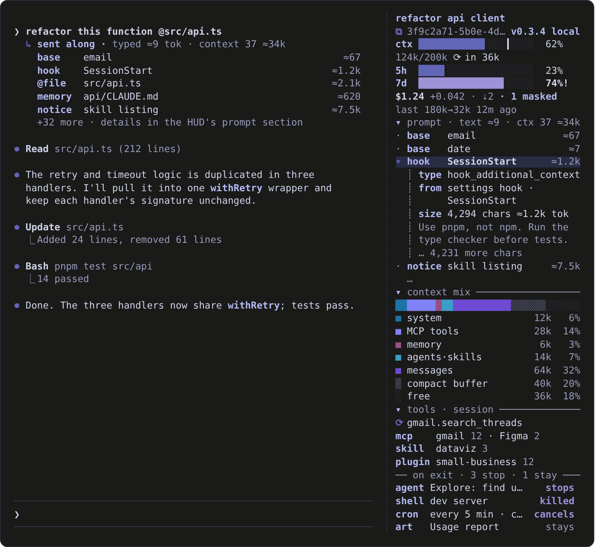

# claude-mods

Mods for [Claude Code](https://claude.com/claude-code): plugins whose function hooks change Claude Code's own interface.

| Mod | What it does |
| --- | --- |
| [usage-hud](#usage-hud) | A dock beside the conversation for context, rate limits, cost, tools, and what each prompt really sent to the model. |

## usage-hud

See what is filling your context and what each prompt carried with it, without leaving the session.

<p align="center">
  
</p>
<p align="center"><sub>Illustration with example data.</sub></p>

### What you get

| Dock section (top to bottom) | Shows |
| --- | --- |
| **Session** | Name and id. Click to copy the name or `claude --resume <id>`. |
| **Gauges** | Context fill with the auto-compaction point marked, 5-hour and 7-day rate limits, session cost and the last turn's share, compactions (before → after). |
| **prompt** | Every block that went to the model with your last prompt, with estimated tokens. Click one for its type, source, size and the head of its text. |
| **context mix** | A stacked bar of what fills the window: system, MCP tools, memory, agents and skills, messages, compact buffer, free. Click a row for its breakdown. |
| **tools** | MCP calls running now, and MCP servers, skills, slash commands, subagents and plugins by use, this session and across sessions. |
| **on exit** | What ending the session stops (subagents, background shells and monitors, session cron jobs, the `/loop` wakeup) and what stays (published artifacts, durable cron jobs, a worktree it will ask about). |

It also:

- **Shows a card under each prompt you type** listing what went with it: `@` files, CLAUDE.md and other first-message blocks, nested memory, hook and plugin context, engine reminders, and pasted images.
- **Keeps compaction summaries useful** by adding instructions on what to preserve.
- **Toasts each turn's** cost, duration and output tokens.
- **Masks known key and token formats** before the session keeps them.

### Install

From a shell:

```sh
claude plugin install usage-hud --marketplace onlyarche/claude-mods
```

At the prompt of a terminal session, run the same thing as `/plugin install usage-hud --marketplace onlyarche/claude-mods`, answer `y` to add the marketplace, then pick a scope (user installs it for every session).

In the desktop app, click **+** next to the prompt box, then **Plugins**, **Add marketplace** with `onlyarche/claude-mods`, then **Add plugin**.

The HUD opens by itself in a fullscreen terminal at least 144 columns wide; on a narrower one, open it with `/usage-hud`. Outside fullscreen, only the top block and the prompt title show, above the prompt.

### Use

| Command | Does |
| --- | --- |
| `/usage-hud` | Open the HUD |
| `/usage-hud 6` | Size the top block to 1/6 of the screen (2–16, default 8); kept across sessions |
| `/usage-hud version` | Show the running version and where it was loaded from |
| `/usage-hud colors` | List the colors in force, what the terminal supports, and any override that did not apply |
| `/usage-hud close` | Close the HUD |

Click a row to open its details under it, and click again to close; one is open at a time. Rows marked `⧉` copy what they name. Click a section title to fold it; folded sections stay folded. When the HUD is taller than the dock, click it and scroll. From the keyboard, press ctrl+x tab to enter the HUD, Tab to move, and Enter to act.

<details>
<summary><strong>Options</strong></summary>

<br>

Set these in `/config` or with `/plugin configure usage-hud@personal-mods`. Changes apply at once.

| Option | Default | |
| --- | --- | --- |
| Compaction instructions | built-in | Added to every compaction's summary, after any you type with `/compact`. Empty uses the built-in text, `off` adds none, and your own text replaces it. |
| Turn cost toast | on | A toast after each turn with its cost, duration and output tokens. |
| Mask secrets | on | Mask known key and token formats. Turn off when working on files like `.env` (see Limits below). |
| Prompt context card | on | The card under each prompt. The HUD's prompt section stays when it is off. |
| Theme color | `#6266b7` | The base color, as `#rrggbb`. Every other color is derived from it. |
| Color overrides | empty | Single colors, as `name=#rrggbb` separated by commas. See Colors below. |

</details>

<details>
<summary><strong>What compaction summaries are told to keep</strong></summary>

<br>

With exact names for paths, symbols, commands, commit hashes and URLs:

1. The goal, what is done, what is in progress, and the exact next step.
2. Every explicit instruction, constraint, preference and correction from the user, quoted verbatim where short.
3. Each file created, edited or deleted: its path, what changed and why.
4. Decisions and their reasons, including rejected approaches.
5. Errors and failed attempts, with the cause and what worked.
6. Facts the work depends on: how the code, tools and APIs behave, and the commands that build, test and run it.
7. Anything changed outside the conversation: pushes, publishes, uploads, installs and running processes, with their identifiers.
8. Open questions, and anything promised but not yet done.

Pleasantries, superseded plans, and tool output already acted on are dropped.

</details>

<details>
<summary><strong>What gets masked</strong></summary>

<br>

Anthropic, OpenAI, GitHub, AWS, Google, Slack, Stripe and Hugging Face keys, JWTs, private keys, and passwords inside URLs become `[REDACTED:kind]`. To add your own formats, edit the `ORG` list in `usage-hud/hooks/secrets.ts`.

</details>

<details>
<summary><strong>Colors</strong></summary>

<br>

The palette is built on `#6266b7` and validated for a dark background. Only the default palette is validated; palettes derived from another Theme color are approximations.

**Override names:** `surface`, `ok`, `warn`, `high` (gauges); `system`, `mcp`, `memory`, `other`, `messages` (context mix); `text`, `muted`, `label`, `mark`, `buffer`, `track`.

**HUD background** (`surface` in Color overrides):

| Value | Background |
| --- | --- |
| empty or `surface=transparent` | The terminal's own, like the conversation beside it |
| `surface=#1e1e2e` | That color |
| `surface=#1e1e2e+3` or `-3` | That color 3% lighter or darker |
| `surface=theme` | The palette's own dark background, `#15161c` |

**24-bit color:** on a terminal without it (macOS Terminal.app, tmux without truecolor), each color is handed over as the nearest of the 256 the terminal has, judged by eye (OKLab). To see the palette exactly in tmux 3.2+:

```sh
# ~/.tmux.conf (older tmux: set -ga terminal-overrides ",*:Tc")
set -g default-terminal "tmux-256color"
set -as terminal-features ",*:RGB"

# shell profile
export COLORTERM=truecolor
```

Restart tmux, then check that `/usage-hud colors` reports `terminal: 24-bit color`. If usage-hud misreads the terminal, set `depth=truecolor`, `depth=256` or `depth=16` in Color overrides.

</details>

<details>
<summary><strong>Limits</strong></summary>

<br>

- **Masking covers what the model sees.** Requests, later requests and compaction summaries are masked, but the tool result the engine stores for display keeps the original, so it can remain in the local transcript. If the model reads a `.env` and then rewrites the whole file, the masked text is what gets written. Turn off Mask secrets for that work.
- **Prompt token counts are estimates** from character counts. A prompt typed while a turn is running may not get a card, and cards do not come back after `--resume`.
- **Plugin hook use is not counted.** No API says which plugin a shell hook belongs to.
- **Session names come from the transcript file**, since no API reads them. A Claude Code update can break this (the id keeps working), and `/rename` takes up to a minute to show.
- **on exit tracks from when the mod loaded.** Only earlier published artifacts and durable cron jobs are restored from the conversation. A background task's end is read from its completion notice, so a missed notice can leave it listed.
- **The dock is at least 24 columns wide.** Long names are cut with `…` at narrow widths; opened details wrap instead.
- **The mod API is early access** and can change between Claude Code versions.

</details>

## Develop

To edit a mod, clone the repository and add it as a folder marketplace. Claude Code then reads the mods straight from the clone, so an edit or a `git pull` takes effect after `/reload-plugins`.

```sh
git clone https://github.com/onlyarche/claude-mods.git ~/.claude/mods
claude plugin marketplace add ~/.claude/mods
claude plugin install usage-hud@personal-mods
```

Check a change, and bump `version` in `plugin.json` so installed copies see the update:

```sh
claude plugin validate ~/.claude/mods/usage-hud
claude plugin test ~/.claude/mods/usage-hud
```

## License

[MIT](LICENSE)
